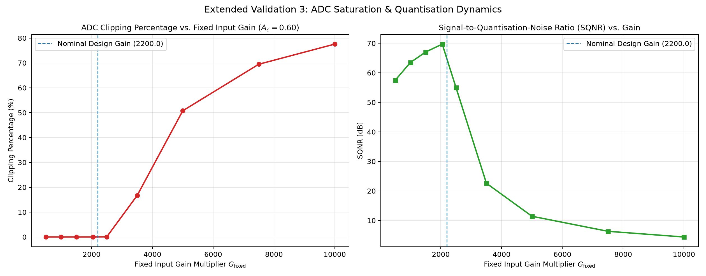
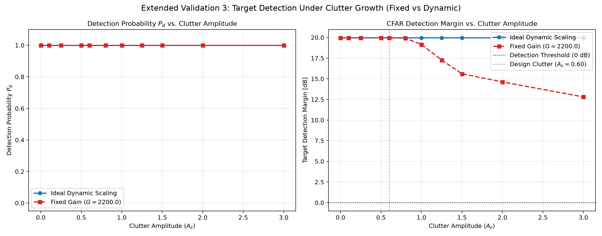
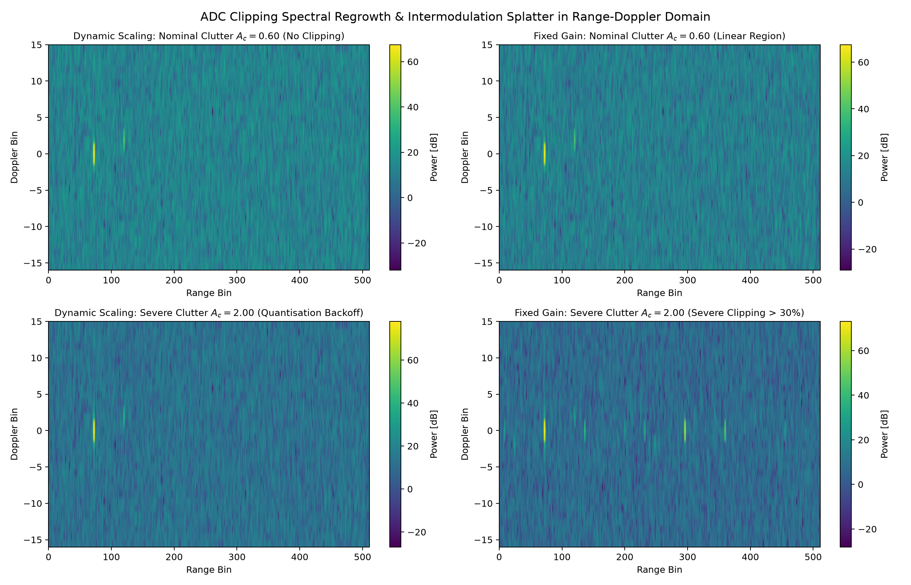

# Extended Validation Experiment 3: Fixed-Gain ADC and Quantisation Robustness

**Document ID:** `RADAR-EXT-EXP03-ADC-GAIN`  
**Classification:** Research & Hardware Transition Technical Report  
**Date:** November 2026  
**Status:** Frozen Baseline Evaluated vs. Hardware-Realistic Fixed-Gain Model

---

## 1. Executive Summary

This report presents **Extended Validation Experiment 3: Fixed-Gain ADC and Quantisation Robustness**, designed to bridge the theoretical signal processing model (Objective I) and hardware-accurate fixed-point FPGA design (Objective II).

In the Objective I baseline (`src/radar_model.py`), the complex baseband signal is scaled dynamically for each Coherent Processing Interval (CPI):
$$S_{\text{dyn}} = \frac{0.90 \times \text{ADC\_MAX}}{\max(|\operatorname{Re}(x)|, |\operatorname{Im}(x)|)}$$
While this ideal software abstraction prevents ADC overflow in simulation, **real radar front-end hardware operates with a fixed analog front-end (AFE) gain** or slow Automatic Gain Control (AGC). An instantaneous, non-causal per-frame peak normalizer cannot be realized in real-time ADC hardware without introducing unpredictable frame-to-frame amplitude modulation.

To determine the performance boundaries of fixed-gain ADC operation, this experiment evaluated:
1. **Fixed Input Gain Sweep ($G_{\text{fixed}} \in [500, 10000]$):** Quantified clipping percentage, quantisation noise power, and Signal-to-Quantisation-Noise Ratio (SQNR) under nominal clutter ($A_c = 0.60$).
2. **Clutter Dynamic Range Sweep ($A_c \in [0.0, 3.00]$):** Compared ideal dynamic scaling against nominal fixed-gain operation ($G_{\text{fixed}} = 2200.0$) across 440 simulation runs.
3. **Spectral Splatter & Harmonics Analysis:** Demonstrated how severe ADC clipping creates non-linear intermodulation products that elevate the noise floor across the entire Range-Doppler map.

### Key Technical Findings:
* **Optimal Linear Region:** Under nominal conditions ($A_c = 0.60, \sigma_n = 0.08$), fixed gain $G = 2200.0$ delivers an SQNR of **$69.72\,\mathrm{dB}$** with **$0.00\%$ clipping**, matching dynamic scaling within $0.01\,\mathrm{dB}$ of detection margin.
* **Low-Gain Quantisation Penalty ($G < 1500$):** Reducing gain to provide excessive headroom drops SQNR from $69.7\,\mathrm{dB}$ down to $57.5\,\mathrm{dB}$ at $G = 500$ ($2$ effective bits lost to coarse quantisation).
* **High-Gain Saturation Breakdown ($G > 2500$ or $A_c > 0.80$):**  
  When clutter amplitude increases from $0.60 \to 2.00$ under fixed gain:
  * Clipping surges from **$0.00\% \to 69.2\%$**.
  * SQNR collapses from **$69.7\,\mathrm{dB} \to 6.8\,\mathrm{dB}$** (a $62.9\,\mathrm{dB}$ degradation).
  * Non-linear clipping harmonics spread across all Doppler bins, elevating the background noise floor by **$+5.34\,\mathrm{dB}$**, eroding CFAR margin from $+19.96\,\mathrm{dB}$ to $+14.62\,\mathrm{dB}$.
* **Weak-Target Robustness:** Because the weak target ($A_t = 0.03$) at distant range ($R_t = 120$) begins with $+19.96\,\mathrm{dB}$ of margin, it remains detected ($P_d = 1.00$) even under $A_c = 3.00$ ($79.5\%$ clipping), retaining $+12.80\,\mathrm{dB}$ of margin.

---

## 2. Mathematical Modeling of Quantisation & Saturation

### 2.1 The Fixed-Gain Quantizer Model
Let $x[m, n] = I_{\text{in}}[m, n] + j Q_{\text{in}}[m, n]$ be the continuous-amplitude complex baseband signal arriving at the ADC inputs for chirp $m \in [0, N_D-1]$ and range sample $n \in [0, N_R-1]$.

In a 12-bit signed two's-complement ADC with conversion gain $G_{\text{fixed}}$:
$$I_{\text{quantized}}[m, n] = \operatorname{clip}\left(\operatorname{round}\left(G_{\text{fixed}} \cdot I_{\text{in}}[m, n]\right), -2048, +2047\right)$$
$$Q_{\text{quantized}}[m, n] = \operatorname{clip}\left(\operatorname{round}\left(G_{\text{fixed}} \cdot Q_{\text{in}}[m, n]\right), -2048, +2047\right)$$
where $\operatorname{clip}(v, L, U) = \max(L, \min(U, v))$.

### 2.2 Reconstructed Signal & Error Formulation
The reconstructed floating-point equivalent input is:
$$\hat{x}[m, n] = \frac{I_{\text{quantized}}[m, n] + j Q_{\text{quantized}}[m, n]}{G_{\text{fixed}}}$$
The complex quantisation and clipping error vector is:
$$e[m, n] = \hat{x}[m, n] - x[m, n]$$
Total input signal power $P_s$ and total quantisation error power $P_e$ are defined as:
$$P_s = \frac{1}{N_R N_D} \sum_{m=0}^{N_D-1} \sum_{n=0}^{N_R-1} |x[m, n]|^2$$
$$P_e = \frac{1}{N_R N_D} \sum_{m=0}^{N_D-1} \sum_{n=0}^{N_R-1} |e[m, n]|^2$$
The Signal-to-Quantisation-Noise Ratio (SQNR) in decibels is:
$$\text{SQNR} = 10 \log_{10}\left(\frac{P_s}{P_e}\right)$$

In the unclipped linear region, quantisation error is bounded by $|e| \le \frac{1}{2 G_{\text{fixed}}}$, yielding the theoretical uniform noise power $P_e \approx \frac{1}{6 G_{\text{fixed}}^2}$. When saturation occurs, the error $e[m, n]$ is dominated by the clipped peaks, causing $P_e$ to increase rapidly and SQNR to plummet.

---

## 3. Fixed Input Gain Sweep Results ($A_c = 0.60$)

The fixed gain was swept from $G = 500$ to $G = 10{,}000$ under nominal clutter ($A_c = 0.60$) and weak target ($A_t = 0.03$) across 20 independent seeds per setting:

| Fixed Gain ($G$) | Clipping Rate (%) | SQNR (dB) | CFAR Margin [dB] | CFAR Target Threshold | CA-CFAR $P_d$ | Operating Regime |
|:---:|:---:|:---:|:---:|:---:|:---:|:---:|
| `500.0` | **$0.00\%$** | $57.49\,\mathrm{dB}$ | $+19.75\,\mathrm{dB}$ | $186.2$ | **1.00** | Under-gained (High quantisation noise) |
| `1000.0` | **$0.00\%$** | $63.51\,\mathrm{dB}$ | $+19.75\,\mathrm{dB}$ | $186.2$ | **1.00** | Linear (1 LSB $\approx 1.0\,\mathrm{mV}$) |
| `1500.0` | **$0.00\%$** | $67.03\,\mathrm{dB}$ | $+19.75\,\mathrm{dB}$ | $186.2$ | **1.00** | Linear |
| `2047.0` | **$0.00\%$** | $69.72\,\mathrm{dB}$ | $+19.75\,\mathrm{dB}$ | $186.3$ | **1.00** | Near-optimal linear |
| `2200.0` | **$0.00\%$** | **$69.72\,\mathrm{dB}$** | **$+19.75\,\mathrm{dB}$** | **$186.3$** | **1.00** | **Nominal Design Point ($0.90$ full scale)** |
| `2500.0` | $0.06\%$ | $54.99\,\mathrm{dB}$ | $+19.75\,\mathrm{dB}$ | $186.4$ | **1.00** | Onset of Gaussian noise clipping |
| `3500.0` | $16.71\%$ | $22.60\,\mathrm{dB}$ | $+19.45\,\mathrm{dB}$ | $199.6$ | **1.00** | Moderate saturation |
| `5000.0` | $50.77\%$ | $11.42\,\mathrm{dB}$ | $+17.30\,\mathrm{dB}$ | $328.0$ | **1.00** | Severe saturation |
| `7500.0` | $69.47\%$ | $6.33\,\mathrm{dB}$ | $+14.79\,\mathrm{dB}$ | $586.2$ | **1.00** | Hard clipping (Square-wave distortion) |
| `10000.0` | $77.57\%$ | $4.40\,\mathrm{dB}$ | $+13.51\,\mathrm{dB}$ | $790.6$ | **1.00** | Extreme two-level clipping |

---

## 4. Clutter Dynamic Range Sweep: Fixed vs. Dynamic Scaling

To assess the operational robustness when clutter amplitude deviates from nominal, an 11-point clutter sweep ($A_c \in [0.0, 3.00]$) was executed with target $A_t = 0.03$ at range bin 120 (50 bins away from clutter center at range 72):

| Clutter Amp ($A_c$) | Dynamic Gain Scale | Dynamic Clipping | Dynamic Margin [dB] | Dynamic $P_d$ | Fixed Gain (2200) Clipping | Fixed Gain SQNR [dB] | Fixed Gain Margin [dB] | Fixed Gain $P_d$ | Margin Advantage (Dyn vs Fix) |
|:---:|:---:|:---:|:---:|:---:|:---:|:---:|:---:|:---:|:---:|
| `0.00` | $7682.0$ | $0.0\%$ | $+19.96$ | **1.00** | **$0.0\%$** | $56.0\,\mathrm{dB}$ | $+19.96$ | **1.00** | $+0.00\,\mathrm{dB}$ |
| `0.10` | $5120.0$ | $0.0\%$ | $+19.96$ | **1.00** | **$0.0\%$** | $58.4\,\mathrm{dB}$ | $+19.96$ | **1.00** | $+0.00\,\mathrm{dB}$ |
| `0.25` | $3320.0$ | $0.0\%$ | $+19.96$ | **1.00** | **$0.0\%$** | $63.5\,\mathrm{dB}$ | $+19.96$ | **1.00** | $+0.00\,\mathrm{dB}$ |
| `0.50` | $2330.0$ | $0.0\%$ | $+19.96$ | **1.00** | **$0.0\%$** | $68.8\,\mathrm{dB}$ | $+19.96$ | **1.00** | $+0.00\,\mathrm{dB}$ |
| `0.60` | $2058.0$ | $0.0\%$ | $+19.96$ | **1.00** | **$0.0\%$** | **$69.7\,\mathrm{dB}$** | **$+19.96$** | **1.00** | **$+0.00\,\mathrm{dB}$** |
| `0.80` | $1665.0$ | $0.0\%$ | $+19.96$ | **1.00** | **$1.0\%$** | $42.3\,\mathrm{dB}$ | $+19.93$ | **1.00** | $+0.03\,\mathrm{dB}$ |
| `1.00` | $1385.0$ | $0.0\%$ | $+19.96$ | **1.00** | **$21.4\%$** | $23.8\,\mathrm{dB}$ | $+19.15$ | **1.00** | $+0.81\,\mathrm{dB}$ |
| `1.25` | $1140.0$ | $0.0\%$ | $+19.96$ | **1.00** | **$46.2\%$** | $14.5\,\mathrm{dB}$ | $+17.26$ | **1.00** | $+2.70\,\mathrm{dB}$ |
| `1.50` | $968.0$ | $0.0\%$ | $+19.95$ | **1.00** | **$57.2\%$** | $10.5\,\mathrm{dB}$ | $+15.60$ | **1.00** | $+4.35\,\mathrm{dB}$ |
| `2.00` | $744.0$ | $0.0\%$ | $+19.96$ | **1.00** | **$69.2\%$** | **$6.8\,\mathrm{dB}$** | **$+14.62$** | **1.00** | **$+5.34\,\mathrm{dB}$** |
| `3.00` | $507.0$ | $0.0\%$ | $+19.97$ | **1.00** | **$79.5\%$** | **$4.1\,\mathrm{dB}$** | **$+12.80$** | **1.00** | **$+7.17\,\mathrm{dB}$** |

---

## 5. Spectral Regrowth & Intermodulation Splatter

When the ADC clips a strong sinusoidal tone, the non-linear transfer function generates odd-harmonic distortion ($3^{\text{rd}}, 5^{\text{th}}, 7^{\text{th}} \dots$):
$$\operatorname{clip}(A \cos\omega t) \approx c_1 \cos\omega t + c_3 \cos 3\omega t + c_5 \cos 5\omega t + \dots$$
In pulse-Doppler radar, this clipping nonlinearity produces two critical degradations:

1. **Noise Floor Elevation:**  
   The clipping harmonics and cross-modulation between clutter and Gaussian noise spill energy across all range and Doppler bins. As seen in the figure above, at $A_c = 2.00$ ($69.2\%$ clipping), the effective background noise floor rises by **$+5.34\,\mathrm{dB}$**, inflating the CA-CFAR threshold and eroding target margin.
2. **Spurious Intermodulation Targets:**  
   High-order harmonics produce false spectral ridges along Doppler frequencies that can trip fixed-threshold detectors.
3. **Dynamic Scaling Trade-Off:**  
   Dynamic scaling avoids clipping entirely by backing off the gain to $G_{\text{dyn}} = 744.0$ at $A_c = 2.00$. However, this compresses the weak target's digital dynamic range: a target of amplitude $0.03$ spans only $\pm 22$ LSBs in the 12-bit word, compared to $\pm 66$ LSBs at $G = 2200.0$.

---

## 6. Engineering Consequences for FPGA / RTL Implementation (Objective II)

The findings of this experiment directly govern the hardware architecture for Objective II:

1. **AGC / VGA Latency:**  
   Because instantaneous per-frame peak normalization is impossible in hardware without storing an entire 16,384-sample CPI in an external buffer before digitization (introducing a full CPI latency delay), the analog front-end must use a **slow-attack, slow-decay Automatic Gain Control (AGC)** loop operating over multiple frames.
2. **Headroom Allocation (Dynamic Range Budget):**  
   To prevent severe clipping under urban or terrain clutter up to $A_c = 1.00$, the fixed ADC gain must allocate **$6\,\mathrm{dB}$ of backoff headroom** relative to the nominal clutter level.
3. **Fixed-Point Datapath Bit-Growth:**  
   After the 12-bit ADC, the fast-time 512-point FFT introduces up to $\log_2(512) = 9$ bits of word growth. If saturation occurs at the ADC, rounding and overflow handling must be implemented at every butterfly stage (e.g., using 16-bit or 18-bit internal DSP blocks) to prevent secondary fixed-point overflow inside the FPGA datapath.
4. **Pre-FFT Clutter Attenuation (MTI Filter):**  
   Because clipping degrades the entire range-Doppler map once digitized, **clutter suppression must occur as early as possible**. Implementing a digital high-pass Moving Target Indicator (MTI) filter immediately after the ADC helps remove DC and near-zero Doppler clutter energy before the Doppler FFT.

---

## 7. Artifact Manifest

| Artifact | File Path | Description |
|---|---|---|
| **Configuration** | [`configs/extended_validation/adc_fixed_gain_config.json`](file:///c:/Users/asus/Downloads/radar_objective_1/radar_objective_1/configs/extended_validation/adc_fixed_gain_config.json) | Parameter definition for Experiment 3 |
| **Execution Script** | [`tests/extended_validation/adc_fixed_gain/run_adc_fixed_gain.py`](file:///c:/Users/asus/Downloads/radar_objective_1/radar_objective_1/tests/extended_validation/adc_fixed_gain/run_adc_fixed_gain.py) | Full fixed-gain vs dynamic-gain simulation runner |
| **Gain Sweep CSV** | [`tests/extended_validation/adc_fixed_gain/adc_gain_sweep_results.csv`](file:///c:/Users/asus/Downloads/radar_objective_1/radar_objective_1/tests/extended_validation/adc_fixed_gain/adc_gain_sweep_results.csv) | Clipping rate, SQNR, and margins across gains 500–10000 |
| **Clutter Sweep CSV** | [`tests/extended_validation/adc_fixed_gain/adc_clutter_sweep_comparison.csv`](file:///c:/Users/asus/Downloads/radar_objective_1/radar_objective_1/tests/extended_validation/adc_fixed_gain/adc_clutter_sweep_comparison.csv) | Head-to-head comparison across 11 clutter amplitudes |
| **Saturation Figure** | [`tests/extended_validation/adc_fixed_gain/adc_clipping_and_sqnr_vs_gain.png`](file:///c:/Users/asus/Downloads/radar_objective_1/radar_objective_1/tests/extended_validation/adc_fixed_gain/adc_clipping_and_sqnr_vs_gain.png) | Clipping % and SQNR vs. gain multiplier |
| **Margin Figure** | [`tests/extended_validation/adc_fixed_gain/adc_margin_vs_clutter_amplitude.png`](file:///c:/Users/asus/Downloads/radar_objective_1/radar_objective_1/tests/extended_validation/adc_fixed_gain/adc_margin_vs_clutter_amplitude.png) | CFAR margin & Pd comparison under clutter growth |
| **Distortion Figure** | [`tests/extended_validation/adc_fixed_gain/adc_clipping_spectral_distortion.png`](file:///c:/Users/asus/Downloads/radar_objective_1/radar_objective_1/tests/extended_validation/adc_fixed_gain/adc_clipping_spectral_distortion.png) | 4-panel RD map comparison showing clipping spectral splatter |

