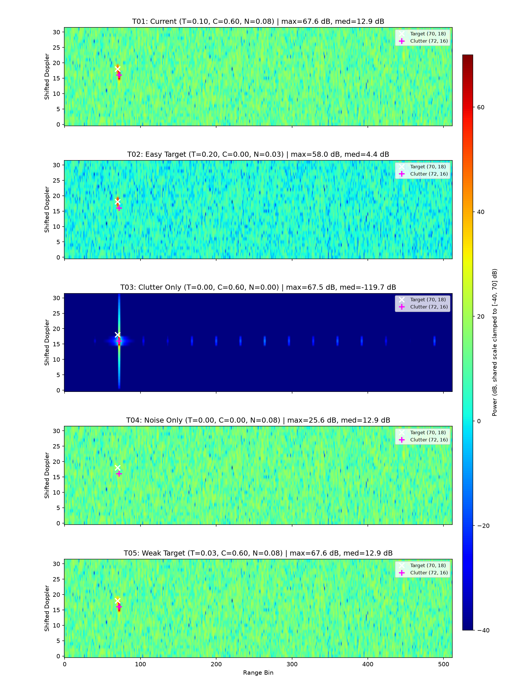
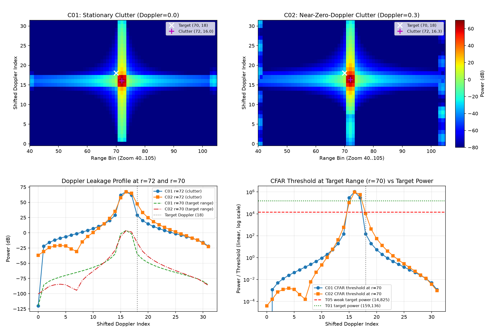
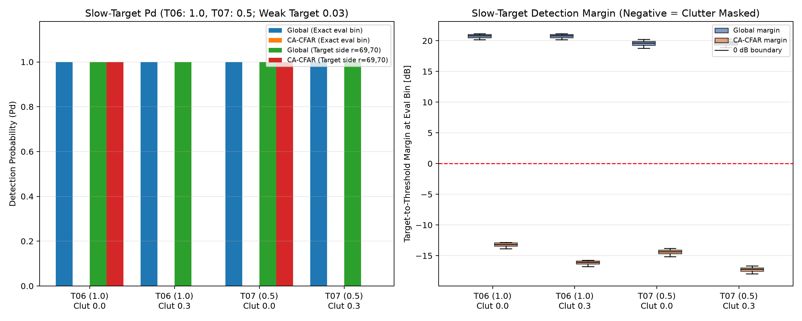
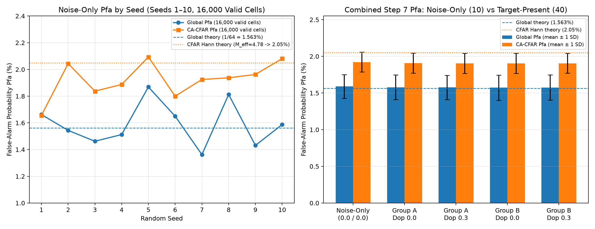
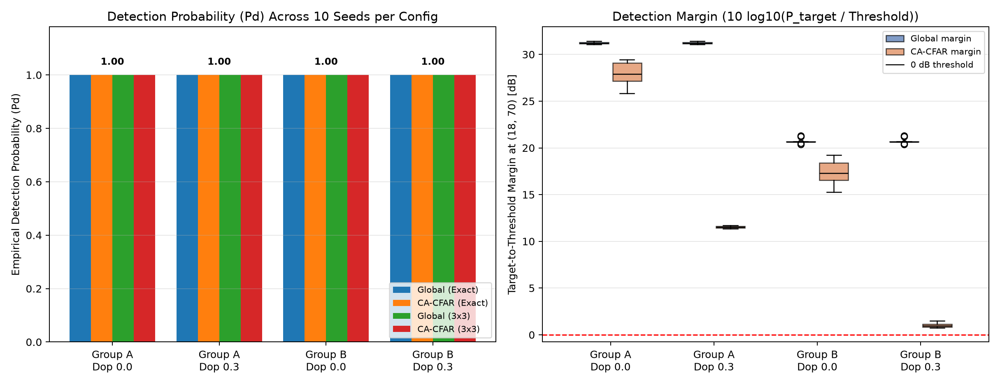
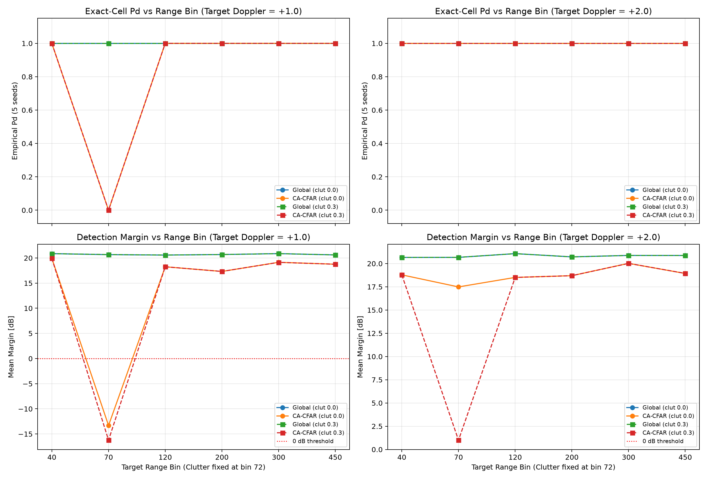
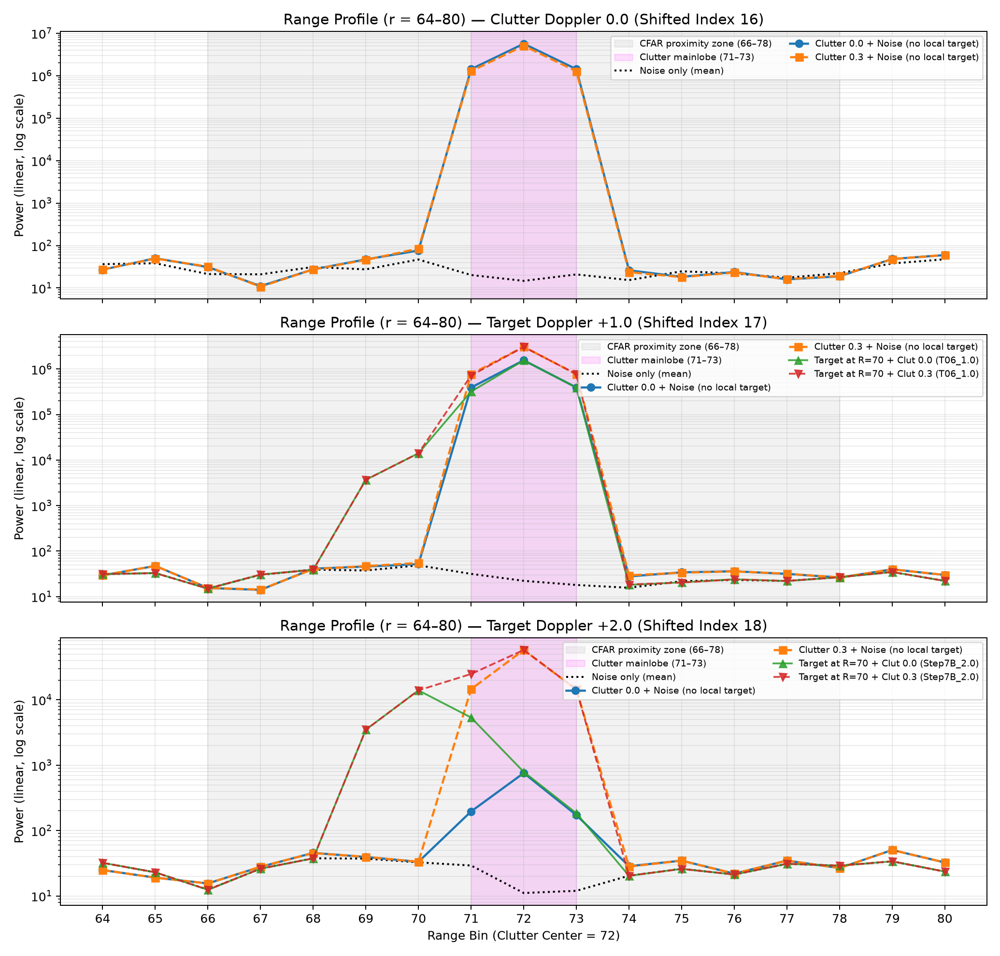
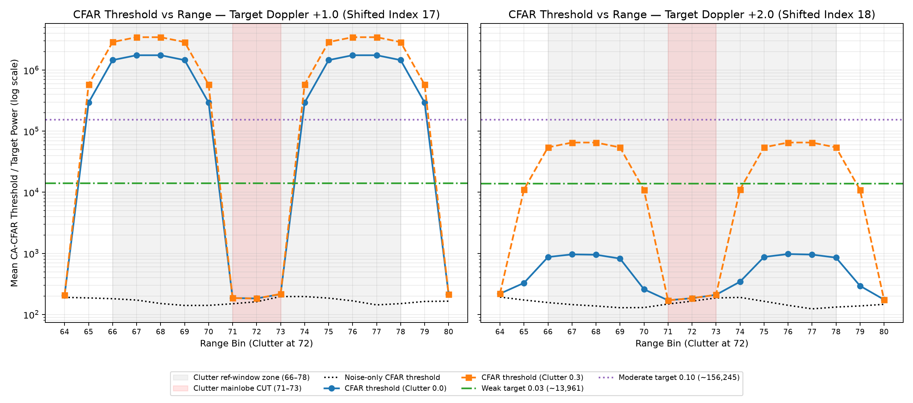
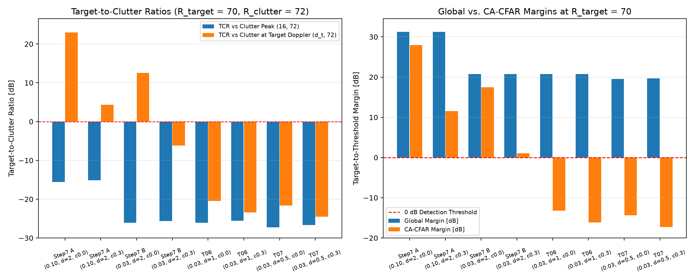

# Objective I — Final Simulation Validation and Technical Documentation

**Project Title:** Development and Simulation of a Radar Signal Processing Model for Weak and Slow-Moving Target Detection in Cluttered Environments  
**Scope:** Software Reference Model, Statistical Validation (217 Simulation Runs), and Architectural Failure Analysis  
**Reference Implementation:** `radar_model.py` (`NR = 512`, `ND = 32`, 12-bit signed I/Q reference pipeline)

---

## 1. Objective and Scope

Objective I establishes, validates, and characterizes a reproducible baseband radar signal-processing simulation model in Python (`radar_model.py`) capable of generating synthetic 2D coherent processing intervals (CPIs), exporting fixed-point 12-bit signed In-phase/Quadrature (I/Q) test vectors, performing two-dimensional windowed Fast Fourier Transform (FFT) Range-Doppler processing, and evaluating two classical detectors—a frame-median **Global Threshold** detector and an adaptive one-dimensional **Cell-Averaging Constant False-Alarm Rate (CA-CFAR)** detector—against weak and slow-moving targets embedded in strong stationary or near-zero-Doppler clutter and additive white Gaussian noise (AWGN).

Within Objective I, the scope is strictly confined to:
1. Formulating and verifying the software baseband signal and noise model (`512` fast-time range samples × `32` slow-time chirps = `16,384` complex samples per frame).
2. Generating bit-exact signed 12-bit integer I/Q stimulus files (`radar_input_iq.txt`) and metadata (`simulation_metadata.npz`) for downstream hardware co-simulation in subsequent project phases.
3. Quantifying empirical detection probability ($P_d$), target-to-threshold margins (dB), and background false-alarm probability ($P_{fa}$) across **217 total runs** spanning controlled single-case diagnostics (`T01–T05`, `C01–C02`), pure noise (`10` seeds), moderate/weak targets (`40` runs), slow/sub-bin Doppler targets (`T06`, `T07`; `40` runs), and range-robustness sweeps (`120` runs).
4. Identifying exact algorithmic failure mechanisms around clutter (mainlobe contamination, near-zero-Doppler leakage, dynamic ADC scaling effects, and detector limitations) prior to Objective II architecture design.

**Hardware Boundary Statement:** All metrics reported in this document originate from floating-point/quantized-input software simulations in Python/NumPy. No RTL/Verilog implementation, synthesis, timing closure, resource utilization, or measured FPGA hardware execution is claimed in Objective I.

---

## 2. Radar System Model and Assumptions

The simulation adopts a normalized, bin-indexed linear-FM/pulse-Doppler baseband data cube discrete-grid abstraction without explicitly binding physical carrier frequency ($f_c$), pulse repetition frequency ($\mathrm{PRF}$), bandwidth ($B$), or range/velocity unit conversions. Each coherent frame is represented as a complex baseband matrix $x[m, n] \in \mathbb{C}$ indexed by:
- Fast-time (intra-chirp / range sample) index $n \in \{0, 1, \dots, N_R - 1\}$, where $N_R = 512$.
- Slow-time (inter-chirp / Doppler pulse) index $m \in \{0, 1, \dots, N_D - 1\}$, where $N_D = 32$.

### Core Modelling Assumptions
1. **Point-Scatterer Superposition:** The received baseband frame is the complex linear sum of one point target, one point-like clutter return, and circular complex AWGN.
2. **Normalized Spatial/Temporal Cycles:** Target and clutter phase progressions are parameterized directly in DFT bin units ($k_R$ cycles per $N_R$ fast-time samples; $k_D$ cycles per $N_D$ slow-time chirps), eliminating RF front-end propagation attenuation, antenna pattern weighting, and range-migration coupling within a single CPI.
3. **Single-Frame Dynamic ADC Full-Scale Mapping:** Prior to DSP, the complex frame is dynamically scaled per frame so its largest real or imaginary sample occupies `90%` of signed 12-bit full scale, then inversely rescaled (`float64`) for the software reference DSP chain.
4. **Sidelobe-Controlled 2D Spectral Analysis:** Separable symmetric Hann windows are applied along fast-time and slow-time prior to unnormalized 2D DFT processing.
5. **1D Range-Only CFAR Topology:** Adaptive threshold estimation slides strictly along the range axis within each Doppler bin independently (`GUARD_CELLS_PER_SIDE = 2`, `REFERENCE_CELLS_PER_SIDE = 4`).
6. **Zero External Interference / Multipath:** No range ambiguity folding, Doppler aliasing beyond signed bin bounds, I/Q imbalance, DC offset, or phase noise is injected.

---

## 3. Mathematical Modelling of Signal Components

Let $n \in \{0, \dots, N_R - 1\}$ denote the fast-time sample index and $m \in \{0, \dots, N_D - 1\}$ denote the slow-time chirp index generated via `np.meshgrid(n, m)`.

### 3.1 Moving Target Model
The complex baseband moving target return is modelled as a unit-modulus-scaled complex sinusoid in fast-time and slow-time:

$$s_t[m, n] = A_t \exp\left( j 2\pi \left( \frac{r_t \, n}{N_R} + \frac{d_t \, m}{N_D} \right) \right)$$

where:
- $s_t[m, n] \in \mathbb{C}$: Complex target baseband sample at chirp $m$ and fast-time index $n$.
- $A_t \ge 0$: Configured real target amplitude (`TARGET_AMPLITUDE`; tested at $0.20$, $0.10$, $0.03$, and $0.00$).
- $r_t \in \{0, \dots, N_R - 1\}$: Target fast-time range bin (`TARGET_RANGE_BIN`; baseline $70$, swept across $\{40, 70, 120, 200, 300, 450\}$).
- $d_t \in [-N_D/2, (N_D-1)/2]$: Signed target Doppler bin (`TARGET_DOPPLER_BIN`; tested at $+2.0$, $+1.0$, and fractional $+0.5$).
- $N_R = 512$, $N_D = 32$: Range and Doppler FFT sizes.
- $j = \sqrt{-1}$: Imaginary unit.

### 3.2 Stationary Clutter Model
When `CLUTTER_DOPPLER_BIN = 0.0` (experiment `C01` and stationary multi-seed runs), clutter has zero inter-chirp phase progression ($d_c = 0.0$):

$$s_{c,\text{stat}}[m, n] = A_c \exp\left( j 2\pi \frac{r_c \, n}{N_R} \right)$$

where:
- $s_{c,\text{stat}}[m, n] \in \mathbb{C}$: Stationary clutter sample at $(m, n)$.
- $A_c \ge 0$: Clutter amplitude (`CLUTTER_AMPLITUDE = 0.60`, i.e., $+15.56\,\mathrm{dB}$ relative to $0.10$ moderate target and $+26.02\,\mathrm{dB}$ relative to $0.03$ weak target in raw voltage amplitude).
- $r_c = 72$: Configured clutter range bin (`CLUTTER_RANGE_BIN`, deliberately placed only $\Delta r = 2$ range bins from the baseline target at $r_t = 70$).

### 3.3 Near-Zero-Doppler Clutter Model
To model slowly fluctuating ground/sea/foliage clutter without integer bin alignment, Step 6 generalized the clutter phase equation using continuous signed Doppler $d_c$ (`CLUTTER_DOPPLER_BIN`):

$$s_c[m, n] = A_c \exp\left( j 2\pi \left( \frac{r_c \, n}{N_R} + \frac{d_c \, m}{N_D} \right) \right)$$

where:
- $d_c \in [-N_D/2, (N_D-1)/2]$: Signed clutter Doppler bin (`CLUTTER_DOPPLER_BIN = 0.0` for stationary clutter; `0.3` bins for near-zero-Doppler clutter).
- Because $d_c = 0.3$ is non-integer relative to $N_D = 32$, slow-time periodicity across the CPI is broken, introducing spectral leakage across neighboring positive and negative Doppler bins—violating the exact Hann-window nulls at integer Doppler separations.

### 3.4 Additive White Gaussian Noise (AWGN)
Thermal receiver noise is generated as independent, identically distributed (i.i.d.) zero-mean circular complex Gaussian samples:

$$w[m, n] = \sigma_n \left( \eta_I[m, n] + j \, \eta_Q[m, n] \right), \qquad \eta_I[m, n], \, \eta_Q[m, n] \stackrel{\text{i.i.d.}}{\sim} \mathcal{N}(0, 1)$$

where:
- $\sigma_n \ge 0$: Standard deviation per I/Q quadrature component (`NOISE_AMPLITUDE`, baseline $0.08$, easy-target $0.03$, noiseless clutter-only $0.00$).
- $\eta_I, \eta_Q$: Independent standard normal random variables drawn via `np.random.randn(ND, NR)`.
- Total noise variance (mean per-sample complex noise power) is:

$$\mathbb{E}\left[ |w[m, n]|^2 \right] = 2 \sigma_n^2$$

For $\sigma_n = 0.08$, $\mathbb{E}[|w[m,n]|^2] = 0.0128$.

### 3.5 Composite Received Signal
The complete continuous floating-point baseband CPI tensor is:

$$x[m, n] = s_t[m, n] + s_c[m, n] + w[m, n]$$

---

## 4. Synthetic I/Q Signal Generation

To prepare identical digital stimuli for fixed-point FPGA development while keeping the Python software model consistent with quantized ADC inputs, `radar_model.py` implements signed $B$-bit fixed-point quantization ($B = \mathrm{ADC\_BITS} = 12$):

1. **Integer Bounds:**
   $$Q_{\max} = 2^{B-1} - 1 = 2047, \qquad Q_{\min} = -2^{B-1} = -2048$$
2. **Per-Frame Dynamic Scaling Factor ($S$):**
   $$M_{\max} = \max\left( \max_{m,n} |\operatorname{Re}\{x[m,n]\}|, \; \max_{m,n} |\operatorname{Im}\{x[m,n]\}| \right)$$
   $$S = \begin{cases} \dfrac{0.90 \, Q_{\max}}{M_{\max}} = \dfrac{1842.3}{M_{\max}}, & M_{\max} > 0 \\ 1.0, & M_{\max} = 0 \end{cases}$$
   where $0.90$ leaves `10%` peak-headroom against overflow within that specific frame.
3. **Rounding, Saturation, and Integer Export:**
   $$I_q[m, n] = \operatorname{clip}\!\left(\operatorname{round}\!\left(S \cdot \operatorname{Re}\{x[m,n]\}\right), \; Q_{\min}, \; Q_{\max}\right) \in \mathbb{Z}$$
   $$Q_q[m, n] = \operatorname{clip}\!\left(\operatorname{round}\!\left(S \cdot \operatorname{Im}\{x[m,n]\}\right), \; Q_{\min}, \; Q_{\max}\right) \in \mathbb{Z}$$
   Integer pairs $(I_q[m,n], Q_q[m,n])$ are written in **chirp-major row order** ($32 \times 512 = 16,384$ lines) to `radar_input_iq.txt`.
4. **Software De-Quantized Reference Input:**
   $$x_{\text{ref}}[m, n] = \frac{I_q[m, n] + j \, Q_q[m, n]}{S}$$
   Thus, the downstream FFT consumes 12-bit quantization-distorted complex samples rescaled back to normalized floating-point units (`float64`). Uniform quantization introduces additive step noise with nominal LSB variance $\Delta_q^2 / 12$ per axis where $\Delta_q = 1 / S$.

---

## 5. Range-Doppler Processing

Two-dimensional coherent pulse-Doppler compression maps $(m, n) \mapsto (k_d, k_r)$ across slow-time frequency index $k_d \in \{0, \dots, N_D - 1\}$ and fast-time range frequency index $k_r \in \{0, \dots, N_R - 1\}$.

1. **Range Compression (1D DFT along `axis=1`):**
   $$X_R[m, k_r] = \sum_{n=0}^{N_R - 1} w_r[n] \, x_{\text{ref}}[m, n] \, \exp\!\left( -j \frac{2\pi \, k_r \, n}{N_R} \right)$$
2. **Doppler Compression (1D DFT along `axis=0`):**
   $$X_{RD,\text{raw}}[k_d', k_r] = \sum_{m=0}^{N_D - 1} w_d[m] \, X_R[m, k_r] \, \exp\!\left( -j \frac{2\pi \, k_d' \, m}{N_D} \right)$$
3. **Zero-Doppler Centering (`fftshift` along `axis=0`):**
   Let $k_d \in \{0, \dots, N_D - 1\}$ be the shifted Doppler display index where $k_d = N_D / 2 = 16$ corresponds to zero Doppler ($d = 0$):
   $$X_{RD}[k_d, k_r] = X_{RD,\text{raw}}\!\left[\left(k_d - \frac{N_D}{2}\right) \bmod N_D, \; k_r\right]$$
   Conversely, any configured signed Doppler bin $d$ maps to shifted index:
   $$k_{d,\text{shifted}}(d) = \left(d + \frac{N_D}{2}\right) \bmod N_D = (d + 16) \bmod 32$$
   Specifically: clutter at $d_c = 0.0 \mapsto 16.0$, near-zero clutter at $d_c = 0.3 \mapsto 16.3$, slow target at $d_t = +0.5 \mapsto 16.5$ (nearest integer upper bin evaluated at $17$, alongside bin $16$), $d_t = +1.0 \mapsto 17$, and $d_t = +2.0 \mapsto 18$.
4. **Magnitude-Squared Power Map and Log Display:**
   $$P[k_d, k_r] = \left| X_{RD}[k_d, k_r] \right|^2, \qquad P_{\text{dB}}[k_d, k_r] = 10 \log_{10}\!\left(P[k_d, k_r] + 10^{-12}\right)$$
   where $10^{-12}$ prevents $\log_{10}(0)$ singularities on noiseless bins.

---

## 6. Windowing and FFT Implementation

`radar_model.py` uses NumPy’s symmetric periodic-endpoint-inclusive **Hann window** (`np.hanning`):

$$w_r[n] = \frac{1}{2}\left(1 - \cos\!\left(\frac{2\pi n}{N_R - 1}\right)\right), \qquad n = 0, \dots, N_R - 1$$
$$w_d[m] = \frac{1}{2}\left(1 - \cos\!\left(\frac{2\pi m}{N_D - 1}\right)\right), \qquad m = 0, \dots, N_D - 1$$

Important spectral properties of `np.hanning` observed in the model:
- **1D and 2D Window Gain Definitions:**
  - **1D Range Hann ($N_R = 512$):**
    $$\sum_{n=0}^{511} w_r[n] = 255.5000, \qquad G_{c,r} = \left(\sum_{n=0}^{511} w_r[n]\right)^2 = 65{,}280.2500 \;\; (+48.15\,\mathrm{dB})$$
    $$G_{n,r} = \sum_{n=0}^{511} w_r[n]^2 = 191.6250 \;\; (+22.83\,\mathrm{dB}), \qquad \mathrm{PG}_r = \frac{G_{c,r}}{G_{n,r}} = 340.6667 \;\; (+25.32\,\mathrm{dB})$$
    *(Processing loss relative to rectangular window $+27.09\,\mathrm{dB}$ is $1.77\,\mathrm{dB}$).*
  - **1D Doppler Hann ($N_D = 32$):**
    $$\sum_{m=0}^{31} w_d[m] = 15.5000, \qquad G_{c,d} = \left(\sum_{m=0}^{31} w_d[m]\right)^2 = 240.2500 \;\; (+23.81\,\mathrm{dB})$$
    $$G_{n,d} = \sum_{m=0}^{31} w_d[m]^2 = 11.6250 \;\; (+10.65\,\mathrm{dB}), \qquad \mathrm{PG}_d = \frac{G_{c,d}}{G_{n,d}} = 20.6667 \;\; (+13.15\,\mathrm{dB})$$
    *(Processing loss relative to rectangular window $+15.05\,\mathrm{dB}$ is $1.90\,\mathrm{dB}$).*
  - **2D Product Hann ($512 \times 32 = 16{,}384$ samples):**
    $$\sum_{n,m} w[n,m] = 255.5 \times 15.5 = 3{,}960.2500$$
    $$G_c = G_{c,r} G_{c,d} = (3{,}960.25)^2 = 15{,}683{,}580.0625 \;\; (+71.95\,\mathrm{dB})$$
    $$G_n = G_{n,r} G_{n,d} = 191.625 \times 11.625 = 2{,}227.640625 \;\; (+33.48\,\mathrm{dB})$$
    $$\mathrm{PG} = \frac{G_c}{G_n} = 7{,}040.4444 \;\; (+38.48\,\mathrm{dB})$$
    *(Net 2D window processing loss relative to rectangular window $+42.14\,\mathrm{dB}$ is $3.67\,\mathrm{dB}$).*
- **Normalization Convention & Output Peak Scaling:**
  NumPy’s `np.fft.fft` computes an unnormalized discrete Fourier transform ($X[k] = \sum_{n=0}^{N-1} x[n] e^{-j 2\pi k n / N}$). Consequently, an on-grid complex sinusoid with amplitude $A$ produces a 2D peak power in the unnormalized Range-Doppler map of $P_{\text{peak}} = A^2 G_c = A^2 \times 15{,}683{,}580.0625$:
  - Predicted clutter peak ($A_c = 0.60$, $d_c = 0.0$): $0.60^2 \times G_c = 5{,}646{,}088.8$ (observed in `C01`/`T03`: `5,646,239.4`).
  - Predicted weak target peak ($A_t = 0.03$, integer bin): $0.03^2 \times G_c = 14{,}115.2$ (observed mean in `T06` at $d=+1$: `14,056`; `Step 7 Group B` at $d=+2$: `13,954`).
  - Predicted moderate target peak ($A_t = 0.10$, integer bin): $0.10^2 \times G_c = 156{,}835.8$ (observed mean in `Step 7 Group A`: `156,224`).
- **Incoherent Noise Power per RD Cell:**
  Under circular complex AWGN with $\sigma_n = 0.08$ (real and imag variance $\sigma_n^2$), the theoretical mean noise power per cell is:
  $$\mu_N = \mathbb{E}[P_{\text{noise}}] = 2\sigma_n^2 \, G_n = 2(0.08)^2 (2227.640625) = 28.5138$$
- **Mainlobe Spread and Null Behavior:** Hann weighting widens an integer-bin tone into a **3-bin mainlobe** (`[k-1, k, k+1]`): clutter at $r_c = 72, d_c = 0$ puts large mainlobe energy into range bins **`{71, 72, 73}`** (with $\sim 0.25\times$ peak power at $71$ and $73$) and Doppler bins **`{15, 16, 17}`** ($\sim 1.55 \times 10^6$ at $(17, 72)$). At Doppler bin $d = +2$ ($k_d = 18$), an *integer* $d_c = 0.0$ clutter tone nearly hits a Hann zero ($\sim 759$–$798$ mean clutter+noise power at $(18, 72)$), whereas fractional $d_c = 0.3$ shifts the clutter off-grid, filling the `d = +2` null to `~57,800` (**~75×–76× higher leakage**).
- **Adjacent-Bin Noise Correlation Along Range:** Because `np.hanning(512)` tapers in time, adjacent range DFT bins are correlated. The discrete power correlation between range bins at lags $0, 1, 2, 3$ is **`1.0000`, `0.4459`, `0.0282`, and `0.0000`** ($|\rho(1)| = 0.6677, |\rho(2)| = 0.1680$).

---

## 7. Global Threshold Detection

The baseline non-adaptive detector computes a single scalar threshold per CPI from the global frame median of $P[k_d, k_r]$:

$$\hat{\mu}_{\text{med}} = \operatorname{median}_{k_d, k_r}\!\left( P[k_d, k_r] \right), \qquad T_{\text{global}} = K_{\text{glob}} \cdot \hat{\mu}_{\text{med}}$$

$$D_{\text{global}}[k_d, k_r] = \mathbb{I}\!\left( P[k_d, k_r] > T_{\text{global}} \right)$$

where:
- $K_{\text{glob}} = \mathrm{THRESHOLD\_FACTOR} = 6.0$.
- Under pure circular complex AWGN, each cell's power follows an Exponential distribution $P \sim \mathrm{Exp}(\text{mean} = \mu_N)$, whose population median is $\mu_N \ln 2$. Thus:
  - Expected global threshold ($\sigma_n = 0.08$): $T_{\text{global}} \approx 6 \ln(2) \mu_N = 118.59$ (observed noise-only 10-seed mean: `117.41`).
  - Theoretical false-alarm probability:
    $$P_{fa,\text{global}}^{\text{theory}} = \mathbb{P}(P > 6 \mu_N \ln 2) = e^{-6 \ln 2} = 2^{-6} = \frac{1}{64} = 0.015625 \;\; (1.5625\%)$$

Because $T_{\text{global}}$ relies on the **global frame median** ($>50\%$ of the $16,384$ cells are background noise), it is invariant to localized clutter peaks—but fails catastrophically whenever noise is absent (`T03`, `C01`, `C02`, where median quantization floor $\sim 10^{-14}$ drives $T_{\text{global}} \approx 0.000000$) or whenever spatially distributed clutter fills $>50\%$ of cells.

---

## 8. CA-CFAR Detection

`radar_model.py` implements a **one-dimensional range-only Cell-Averaging CFAR (CA-CFAR)** sliding window along fast-time for each Doppler row $k_d \in \{0, \dots, 31\}$ independently:

- **Guard cells per side:** $G = \mathrm{GUARD\_CELLS\_PER\_SIDE} = 2$.
- **Reference cells per side:** $N_{\text{side}} = \mathrm{REFERENCE\_CELLS\_PER\_SIDE} = 4$ (total reference cells $N_{\text{ref}} = 2 N_{\text{side}} = 8$).
- **Edge exclusion:** $E = G + N_{\text{side}} = 6$; only range indices $k_r \in [6, 505]$ ($500$ range cells per Doppler bin, totaling **`16,000`** valid cells per frame) are evaluated (`cfar_valid_mask`). Cells outside $[6, 505]$ default to `False` detections and `NaN` thresholds.

For each valid cell under test (CUT) at $(k_d, k_r)$, the reference index set is:

$$\mathcal{R}(k_r) = \{k_r - 6, k_r - 5, k_r - 4, k_r - 3\} \cup \{k_r + 3, k_r + 4, k_r + 5, k_r + 6\}$$

The local noise estimate, adaptive threshold, and binary CFAR decision are:

$$\hat{\mu}_{\text{CFAR}}[k_d, k_r] = \frac{1}{8} \sum_{u \in \mathcal{R}} P[k_d, u], \qquad T_{\text{CFAR}}[k_d, k_r] = \alpha_{\text{CFAR}} \, \hat{\mu}_{\text{CFAR}}[k_d, k_r]$$

$$D_{\text{CFAR}}[k_d, k_r] = \mathbb{I}\!\left( P[k_d, k_r] > T_{\text{CFAR}}[k_d, k_r] \right) \quad \text{for } 6 \le k_r \le 505$$

where $\alpha_{\text{CFAR}} = \mathrm{CFAR\_ALPHA} = 6.0$.

### Theoretical vs. Hann-Correlated $P_{fa}$
- **Zero CUT-to-Reference Correlation:** The guard interval ($G = 2$) places the nearest reference cells at lag $|\Delta r| = 3$. Because the Hann range correlation at lag 3 is negligible ($\rho^2(3) < 10^{-7} \approx 0.0000$), the **CUT is statistically uncorrelated with all 8 reference cells** under circular AWGN.
- **Classical i.i.d. Exponential Assumption:**
  If all $N_{\text{ref}} = 8$ reference cells were mutually independent, the sum of 8 independent exponential variates follows an Erlang-8 distribution, yielding the classical CA-CFAR false-alarm formula:
  $$P_{fa,\text{CFAR}}^{\text{i.i.d.}} = \left(1 + \frac{\alpha_{\text{CFAR}}}{N_{\text{ref}}}\right)^{-N_{\text{ref}}} = \left(1 + \frac{6.0}{8}\right)^{-8} = (1.75)^{-8} = \frac{1}{87.96093} \approx 0.011368 \;\; (1.137\%)$$
- **Hann-Induced Correlation and Effective Reference Count ($N_{\text{eff}}$):**
  In reality, the 8 reference cells are sampled along range fast-time under `np.hanning(512)`:
  - $\mathcal{R}_{\text{left}} = \{k_r - 6, k_r - 5, k_r - 4, k_r - 3\}$ (4 contiguous cells)
  - $\mathcal{R}_{\text{right}} = \{k_r + 3, k_r + 4, k_r + 5, k_r + 6\}$ (4 contiguous cells)
  Because $\mathcal{R}_{\text{left}}$ and $\mathcal{R}_{\text{right}}$ are separated by a minimum of $3 - (-3) = 6$ bins, cross-block correlation is zero ($\rho^2(\ge 6) < 10^{-10}$). Thus, the $8 \times 8$ covariance matrix $C$ is block-diagonal with two identical $4 \times 4$ blocks $C_{\text{side}}$:
  $$C_{\text{side}} = \begin{bmatrix} 1 & \rho(1) & \rho(2) & \rho(3) \\ \rho^*(1) & 1 & \rho(1) & \rho(2) \\ \rho^*(2) & \rho^*(1) & 1 & \rho(1) \\ \rho^*(3) & \rho^*(2) & \rho^*(1) & 1 \end{bmatrix}, \quad \text{with } |\rho(1)|^2 = 0.44589, \; |\rho(2)|^2 = 0.02823, \; |\rho(3)|^2 \approx 0$$
  Evaluating the traces:
  $$\operatorname{Tr}(C_{\text{side}}) = 4.0, \qquad \operatorname{Tr}(C_{\text{side}}^2) = 4 + 2(3 |\rho(1)|^2 + 2 |\rho(2)|^2) = 4 + 2(1.33768 + 0.05647) = 6.7883$$
  For the combined 8-cell window:
  $$\operatorname{Tr}(C) = 2 \operatorname{Tr}(C_{\text{side}}) = 8.0, \qquad \operatorname{Tr}(C^2) = 2 \operatorname{Tr}(C_{\text{side}}^2) = 13.5766$$
  The effective number of independent averaging cells is:
  $$N_{\text{eff}} = \frac{[\operatorname{Tr}(C)]^2}{\operatorname{Tr}(C^2)} = \frac{64.0}{13.5766} = 4.7141 \approx 4.71$$
  Substituting $N_{\text{eff}} = 4.7141$ into the CA-CFAR characteristic function:
  $$P_{fa,\text{CFAR}}^{\text{Hann}} \approx \left(1 + \frac{\alpha_{\text{CFAR}}}{N_{\text{eff}}}\right)^{-N_{\text{eff}}} = \left(1 + \frac{6.0}{4.7141}\right)^{-4.7141} = (2.2727)^{-4.7141} \approx 0.02085 \;\; (2.09\%)$$
  Window-induced correlation inflates the estimator variance $\operatorname{Var}(\hat{\mu}_{\text{CFAR}})$, widening the threshold fluctuations and elevating pure-noise false alarms from $1.137\%$ to $\approx 2.09\%$, in close agreement with the empirical 10-seed noise-only measurement of **`1.923% ± 0.136%`** (Section 12).

---

## 9. Simulation Parameters and Configurations

### Fixed Architectural & Detector Parameters (Held Constant Across All 217 Runs)

| Parameter | Symbol / Variable | Value | Role |
|---|---|---:|---|
| Range samples / FFT size | `NR` ($N_R$) | `512` | Fast-time bins per chirp |
| Slow-time chirps / Doppler FFT size | `ND` ($N_D$) | `32` | Slow-time bins per CPI |
| Clutter range bin | `CLUTTER_RANGE_BIN` ($r_c$) | `72` | Fixed scatterer location |
| ADC resolution | `ADC_BITS` ($B$) | `12` bits | Signed `[-2048, +2047]` I/Q |
| ADC headroom factor | Fixed constant | `0.90` | Max amplitude utilization |
| Range & Doppler windows | `np.hanning` | `512`, `32` | Symmetric Hann tapering |
| Global multiplier | `THRESHOLD_FACTOR` ($K_{\text{glob}}$) | `6.0` | Multiplies frame median |
| CFAR guard cells / side | `GUARD_CELLS_PER_SIDE` ($G$) | `2` | Total 4 guard bins |
| CFAR reference cells / side | `REFERENCE_CELLS_PER_SIDE` ($N_{\text{side}}$) | `4` | Total 8 reference bins |
| CFAR edge exclusion | `edge_size` ($E$) | `6` | Valid range `[6, 505]` (`16,000` cells) |
| CFAR multiplier | `CFAR_ALPHA` ($\alpha_{\text{CFAR}}$) | `6.0` | Multiplies local mean |

### Experiment Suite Configurations (217 Total Simulation Runs)

| Suite | Cases / Configs | $A_t$ | $A_c$ | $\sigma_n$ | $r_t$ | $d_t$ | $d_c$ | Seeds | Runs | Output Folder |
|---|---|---:|---:|---:|---:|---:|---:|---|---:|---|
| **T01–T05** Diagnostics | 5 controlled cases | 0.00–0.20 | 0.00 / 0.60 | 0.00–0.08 | 70 | +2.0 | 0.0 | seed `42` | 5 | `outputs_512x32_T01..T05` |
| **C01–C02** Step 6 Clutter | Stationary vs. near-zero | 0.00 | 0.60 | 0.00 | (70) | (+2.0) | 0.0 / 0.3 | seed `42` | 2 | `outputs_512x32_C01..C02` |
| **Step 7 Multi-Seed** (A & B) | 2 amps × 2 clutter Dop. | 0.10, 0.03 | 0.60 | 0.08 | 70 | +2.0 | 0.0, 0.3 | `1–10` | 40 | `outputs_512x32_step7_multiseed` |
| **Step 7 Noise-Only** | Pure AWGN baseline | 0.00 | 0.00 | 0.08 | — | — | — | `1–10` | 10 | `outputs_512x32_step7_noise_only` |
| **T06 & T07** Slow Targets | 2 target Dop. × 2 clutter | 0.03 | 0.60 | 0.08 | 70 | +1.0, +0.5 | 0.0, 0.3 | `1–10` | 40 | `outputs_512x32_slow_targets` |
| **Range Robustness** | 6 ranges × 2 Dop. × 2 clut. | 0.03 | 0.60 | 0.08 | `{40,70,120,200,300,450}` | +1.0, +2.0 | 0.0, 0.3 | `1–5` | 120 | `outputs_512x32_range_robustness` |
| **Clutter-Proximity Analysis** | Post-hoc synthesis across 210 multi-seed runs | — | — | — | bins `64–80` | 0, +1, +2 | 0.0, 0.3 | existing | — | `outputs_512x32_clutter_investigation` |

*Reconciliation Note:* The 217 total project simulations comprise **7 deterministic benchmark runs** (`T01–T05` and `C01–C02` at fixed seed 42) plus **210 multi-seed statistical sweep runs** (40 Step 7 target-present runs + 10 Step 7 noise-only runs + 40 slow-target `T06/T07` runs + 120 range-robustness runs). Every single run has been audited and verified to contain valid metadata and an exact 16,384-line 12-bit signed I/Q text export.

---

## 10. Experimental Methodology

1. **Isolation of `radar_model.py`:** After Step 6 added `CLUTTER_DOPPLER_BIN` and `clutter_doppler_shifted` metadata, `radar_model.py` and all detector settings were frozen. Multi-seed campaigns (`run_slow_target_experiments.py`, `run_range_robustness.py`, and Step 7 scripts) imported/replicated the exact arithmetic independently so every prior output folder stayed preserved.
2. **Input Integrity Checks:** All Step 7 (`50` runs), Slow-Target (`40` runs), and Range-Robustness (`120` runs) executions verified exactly `16,384` lines in `radar_input_iq.txt` with valid signed 12-bit integers in `[-2048, +2047]`.
3. **Unbiased Common False-Alarm Masking:** Audited background $P_{fa}$ compares Global and CA-CFAR on the **exact same CFAR-valid background mask** (`cfar_valid_mask` over $32 \times 500 = 16,000$ cells) excluding:
   - The `3×3` neighborhood centered on the evaluated target cell `(eval_doppler_idx, r_t)`.
   - The fixed `11×3 = 33`-cell clutter ridge across Doppler indices `12..22` and range bins `71..73`.
   - Total background denominator $N_{\text{eval}}$: **`16,000`** cells (noise-only), **`15,961`** cells when $r_t = 70$ (because target `3×3` overlaps `r = 71` in the clutter ridge), and **`15,958`** cells when $r_t \in \{40, 120, 200, 300, 450\}$ (disjoint `3×3` and clutter ridge: $16{,}000 - 9 - 33 = 15{,}958$).
4. **Separation of Exact-Cell vs. Neighbourhood Detection:**
   - **Exact-Cell $P_d$:** Fraction of runs where `(eval_doppler_idx, r_t)` strictly exceeds threshold.
   - **Raw `3×3` $P_d$:** Fraction of runs where *any* cell in `[d_eval-1..d_eval+1, r_t-1..r_t+1]` exceeds threshold (which includes `r = 71` clutter shoulder when $r_t = 70$).
   - **Clutter-Excluded `3×3` $P_d$ (`3×3_noclutter` / `r69_70`):** Evaluates `[d_eval-1..d_eval+1, r_t-1..r_t+1]` excluding clutter bins `r in {71, 72, 73}` so clutter-ridge hits are **never** misattributed as target detections.
5. **Detection Margin Definition:** Target-to-threshold margin at `(d_eval, r_t)` is defined as:
   $$M_{\text{det}} \;[\mathrm{dB}] = 10 \log_{10}\!\left( \frac{P[d_{\text{eval}}, r_t]}{T[d_{\text{eval}}, r_t]} \right)$$

---

## 11. Results from T01–T07 and C01–C02

### 11.1 Controlled Single-Seed Diagnostics (`T01–T05` and `C01–C02`, Seed = `42`)

| Case | $(A_t, A_c, \sigma_n)$ | $(d_t, d_c)$ | Scale $S$ | $P(18, 70)$ | $T_{\text{global}}$ | $T_{\text{CFAR}}(18,70)$ | Global Exact (`valid cnt`) | CFAR Exact (`tot cnt`) | Global / CFAR Margin at `(18,70)` |
|---|---|---|---:|---:|---:|---:|---|---|---|
| **T01** Baseline | `(0.10, 0.60, 0.08)` | `(2.0, 0.0)` | `1895.44` | `159,136.3` | `117.10` | `516.98` | `True` (`257`) | `True` (`312`) | `+31.33` / `+24.88 dB` |
| **T02** Easy target | `(0.20, 0.00, 0.03)` | `(2.0, 0.0)` | `6073.32` | `629,043.2` | `16.45` | `48.26` | `True` (`251`) | `True` (`300`) | `+45.83` / `+41.15 dB` |
| **T03** Clutter only | `(0.00, 0.60, 0.00)` | `(2.0, 0.0)` | `3070.50` | `0.0003` | `3.64e-13` | `144.22` | `True*` (`6494`) | `False` (`1488`) | `+89.56*` / `-56.42 dB` |
| **T04** Noise only | `(0.00, 0.00, 0.08)` | `(2.0, 0.0)` | `5141.40` | `29.13` | `116.90` | `346.73` | `False` (`236`) | `False` (`295`) | `-6.03` / `-10.76 dB` |
| **T05** Weak target | `(0.03, 0.60, 0.08)` | `(2.0, 0.0)` | `2018.24` | `14,825.3` | `117.02` | `518.39` | `True` (`258`) | `True` (`313`) | `+21.03` / `+14.56 dB` |
| **C01** Stat. clutter | `(0.00, 0.60, 0.00)` | `(2.0, 0.0)` | `3070.50` | `0.0003` | `3.64e-13` | `144.22` | `True*` (`6494`) | `False` (`1488`) | `+89.56*` / `-56.42 dB` |
| **C02** `0.3` clutter | `(0.00, 0.60, 0.00)` | `(2.0, 0.3)` | `3070.50` | `0.0248` | `9.30e-12` | `10,879.53` | `True*` (`6229`) | `False` (`1496`) | `+94.26*` / `-56.42 dB` |

*Note (*): Spurious Global detection occurs because $\sigma_n = 0$: the frame median is $6.07 \times 10^{-14}$ (`C01`/`T03`) or $1.55 \times 10^{-12}$ (`C02`), rounding to `0.000000` in text summaries and triggering `>6,200` crossings on 12-bit quantization residuals, including `(18, 70)` (`P = 0.0003–0.0248`). Meanwhile, shifting $d_c$ from `0.0` (`C01`) to `0.3` (`C02`) increases power at `(18, 72)` from `764.69` to `57,685.51` (`75.4×`) and raises $T_{\text{CFAR}}(18, 70)$ from `144.22` to `10,879.53` (`75.4×`).*

*Figure 1: Range-Doppler power maps across T01–T05 (`rd_comparison_t01_t05.png`). Note periodic 12-bit quantization harmonic spurs in noiseless `T03` and dominance of the `(16, 72)` clutter peak (`+67.5 dB`) over the weak target (`T05`).*

*Figure 2: Step 6 comparison of stationary (`C01`, $d_c = 0.0$) vs. near-zero-Doppler (`C02`, $d_c = 0.3$) clutter (`clutter_comparison_c01_c02.png`), showing off-grid Doppler leakage raising the `r = 70` CA-CFAR threshold at `d = +2` (`18`) from `144.2` to `10,879.5`.*

### 11.2 Slow-Moving & Sub-Bin Target Validation (`T06` & `T07`, `R_t = 70`, $A_t = 0.03$, 10 Seeds Each)

| Config (`d_t`, `d_c`) | Eval Bin ($k_d$) | Mean Target Power | Exact Global $P_d$ | Exact CFAR $P_d$ | Raw `3×3` CFAR $P_d$ *(Misleading\*)* | Clutter-Excluded `r69–70` CFAR $P_d$ | Global Margin (dB) | CFAR Margin Mean [Min, Max] (dB) |
|---|---|---:|---:|---:|---:|---:|---:|---|
| **T06** (`1.0`, `0.0`) | `17` | `14,056.1` | `1.00` | **`0.00`** | `1.00*` | `1.00` | `+20.76` | **`-13.20`** `[-13.87, -12.82]` |
| **T06** (`1.0`, `0.3`) | `17` | `14,104.2` | `1.00` | **`0.00`** | `1.00*` | **`0.00`** | `+20.77` | **`-16.13`** `[-16.76, -15.76]` |
| **T07** (`0.5`, `0.0`) | `17` (`16`)** | `10,727.5` | `1.00` | **`0.00`** | `1.00*` | `1.00` | `+19.57` | **`-14.39`** `[-15.13, -13.78]` |
| **T07** (`0.5`, `0.3`) | `17` (`16`)** | `10,914.9` | `1.00` | **`0.00`** | `1.00*` | **`0.00`** | `+19.65` | **`-17.26`** `[-17.97, -16.67]` |

*Note (*): Raw `3×3` around `(17, 70)` overlaps column `r = 71`, where the clutter ridge `(16..17, 71)` fires `10/10` independent of target presence. Excluding `r = 71..73`, the `cdop = 0.0` detections in `r69–70` occur at `(18, 70)`—the target's `+2` Hann Doppler shoulder sitting in stationary clutter's Doppler null (`T_CFAR(18, 70) ≈ 258`); under `cdop = 0.3`, leakage into bin `18` raises `T_CFAR(18, 70)` to `~10.9k` and eliminates even this shoulder detection (`0/10`).*

*Note (**): In `T07` ($d_t = 0.5$, straddle loss $\approx -1.19\,\mathrm{dB}$ vs. `T06`), power splits almost equally between `bin 16` (`10,852` / `11,089`) and `bin 17` (`10,728` / `10,915`); CA-CFAR exact $P_d$ at `bin 16` is also `0.00` (`-19.94` / `-19.37 dB` margin).*

*Figure 3: Slow-target detection results (`slow_targets_pd_margin_comparison.png`). Exact CA-CFAR fails (`Pd = 0.00`, margins `-13.2 to -17.3 dB`) across all 40 runs; clutter-free target-side `r69–70` collapses to `0.00` once `0.3`-bin clutter leakage is introduced.*

---

## 12. Noise-Only Validation

Ten pure-AWGN simulations (`TARGET_AMPLITUDE = 0.0`, `CLUTTER_AMPLITUDE = 0.0`, `NOISE_AMPLITUDE = 0.08`, seeds `1–10`, `outputs_512x32_step7_noise_only/step7_noise_only_results.csv`) tested threshold calibration across the common `16,000` CFAR-valid cells:

- **Global Detector ($K_{\text{glob}} = 6.0$):**
  - Mean global threshold across 10 seeds: `117.41` (theoretical $6 \mu_N \ln 2 = 118.59$).
  - Empirical $P_{fa}$: **`0.015894 ± 0.001624`** (`254.3 ± 26.0` valid false alarms per frame; range `0.01363–0.01869`).
  - Matches exact exponential theory $2^{-6} = \mathbf{0.015625}$ within `+0.17` standard deviations.
- **CA-CFAR Detector ($\alpha_{\text{CFAR}} = 6.0$, $N_{\text{ref}} = 8$):**
  - Mean CFAR threshold across 10 seeds: `169.85` (median `156.40`; theoretical expectation $6 \mu_N = 171.08$).
  - Empirical $P_{fa}$: **`0.019225 ± 0.001356`** (`307.6 ± 21.7` false alarms per frame; range `0.01656–0.02094`).
  - **Theory vs. Observation Gap:** Observed $P_{fa}$ (`1.92%`) is `1.69×` higher than the i.i.d. textbook formula $(1 + 6/8)^{-8} = 0.01137$ (`1.14%`), and agrees closely with the Hann-correlated effective reference count prediction ($\approx 2.09\%$ for $N_{\text{eff}} \approx 4.71$).

*Figure 4: Seed-by-seed noise-only $P_{fa}$ (left) and Step-7 audited comparison (right) from `noise_only_pfa_comparison.png`.*

---

## 13. Multi-Seed Statistical Validation

Step 7 combined `40` target-present runs (`Group A` $A_t = 0.10$, `Group B` $A_t = 0.03$, each tested under $d_c = 0.0$ and $0.3$ across seeds `1–10`, baseline `R_t = 70, d_t = +2.0`) with the `10` noise-only runs (`outputs_512x32_step7_multiseed/step7_combined_50runs_audited_summary.csv`):

| Condition | Exact Global $P_d$ | Exact CFAR $P_d$ | Clutter-Free `3×3` $P_d$ | Global Margin (dB) | CFAR Margin Mean [Min] (dB) | Audited Global $P_{fa}$ (`15,961` / `16,000`) | Audited CFAR $P_{fa}$ (`15,961` / `16,000`) |
|---|---:|---:|---:|---:|---:|---|---|
| **Group A** (`0.10, c=0.0`) | `1.00` | `1.00` | `1.00` | `+31.22` | `+27.98` `[+25.84]` | `0.01571 ± 0.00158` | `0.01907 ± 0.00137` |
| **Group A** (`0.10, c=0.3`) | `1.00` | `1.00` | `1.00` | `+31.23` | **`+11.54`** `[+11.36]` | `0.01569 ± 0.00157` | `0.01905 ± 0.00137` |
| **Group B** (`0.03, c=0.0`) | `1.00` | `1.00` | `1.00` | `+20.73` | `+17.46` `[+15.26]` | `0.01566 ± 0.00161` | `0.01905 ± 0.00137` |
| **Group B** (`0.03, c=0.3`) | `1.00` | `1.00` | `1.00` | `+20.73` | **`+1.04`** `[+0.76]` | `0.01568 ± 0.00162` | `0.01905 ± 0.00136` |
| **Noise Only** (`10` seeds) | — | — | — | — | — | `0.01589 ± 0.00162` | `0.01923 ± 0.00136` |

Key statistical findings from Step 7:
- **Background $P_{fa}$ Invariance:** Across all 50 runs on identical background masks, Global $P_{fa}$ stays strictly within `1.566%–1.589%` and CA-CFAR stays within `1.905%–1.923%`, confirming clean clutter isolation outside `[65..79]` in range and `[12..22]` in Doppler.
- **Clutter-Induced Margin Cliff:** At `R_t = 70, d_t = +2.0`, turning on `0.3`-bin clutter erases **`16.4 dB`** of CA-CFAR detection margin (`+27.98 -> +11.54 dB` for Group A; `+17.46 -> +1.04 dB` for Group B), leaving weak targets within **`+0.76 dB`** of failure at worst seed. Global margin (`~+20.73 dB` weak, `~+31.22 dB` moderate) is unaffected because `r = 73` does not enter the global frame median.

*Figure 5: Step 7 empirical $P_d$ and margin distributions (`pd_comparison.png`), illustrating the `16.4 dB` CA-CFAR margin collapse under `0.3`-bin clutter leakage.*

---

## 14. Range Robustness Analysis

`run_range_robustness.py` swept $r_t \in \{40, 70, 120, 200, 300, 450\}$ for weak targets ($A_t = 0.03$, $\sigma_n = 0.08$, $A_c = 0.60$) at $d_t \in \{+1.0, +2.0\}$ and $d_c \in \{0.0, 0.3\}$ across seeds `1–5` (`120` runs; `outputs_512x32_range_robustness/range_robustness_summary_metrics.csv`):

- **Clutter-Free Ranges ($r_t \in \{40, 120, 200, 300, 450\}$; `100` runs):**
  - **Observed 5/5 Detection per Configuration (100/100 Total Clutter-Free Runs Detected):** Both Global and CA-CFAR achieved empirical $\hat{P}_d = 1.00$ across all 100 tested runs at clutter-free ranges ($0.0$ and $0.3$ clutter, $+1.0$ and $+2.0$ target Doppler). Statistically, for a sample size of $N=5$ seeds per configuration with $5/5$ detections, the exact 95% Clopper-Pearson binomial confidence interval for the true probability of detection is $[0.478, 1.000]$ (and across all 100 aggregated clutter-free runs, $[0.963, 1.000]$). This confirms highly repeatable detectability in all evaluated realization instances, rather than mathematical proof of asymptotic $P_d \equiv 1.0000$.
  - **Healthy Detection Margins:** CA-CFAR mean margins range from **`+17.32 dB`** (`r=200, d=1.0`) to **`+20.02 dB`** (`r=300, d=2.0`), showing zero degradation from clutter at $r_c = 72$.
  - **Consistent Background $P_{fa}$:** Global `1.588%–1.598%` and CA-CFAR `1.869%–1.884%` over `15,958` valid cells.
- **Clutter-Proximal Range ($r_t = 70$; `20` runs):**
  - At $d_t = +1.0$, exact CA-CFAR fails completely (**`Pd = 0.00`**; margins **`-13.31 dB`** at `cdop = 0.0` and **`-16.24 dB`** at `cdop = 0.3`). Under `cdop = 0.3`, clutter-free `3×3` detection is also **`0.00`** (raw `3×3` equals `1.00` solely from the `r = 71` clutter ridge).
  - At $d_t = +2.0$, exact CA-CFAR maintains `1.00` on seeds `1–5`, but `cdop = 0.3` drops the margin from `+17.49 dB` to **`+1.00 dB`** (minimum `+0.76 dB`).
  - Across all `120` runs combined: Global exact $P_d = \mathbf{1.00}$, CA-CFAR exact $P_d = \mathbf{0.9167}$ (`110/120`, with all `10` misses at `r_t = 70, d_t = 1.0`).

*Figure 6: Exact-cell $P_d$ and mean detection margin vs. target range bin (`range_robustness_pd_margin.png`), isolating the failure strictly to clutter proximity at `R = 70`.*

---

## 15. Clutter-Proximity Investigation

> [!NOTE]
> **Methodological Scope of Clutter-Proximity Analysis:**  
> Direct target-present empirical validation in Objective I was executed specifically at $R_t = 70$. The range profile analysis below evaluates the reference-window contamination geometry and calculates the resulting threshold inflation across bins $64–80$ from measured clutter profiles. The complete empirical 680-run target-present sweep across all 17 contiguous bins is formulated as Extended Validation Experiment 1 (with a 4-run pilot verified, and the full sweep pending execution).

`analyze_clutter_proximity.py` inspected bins `64–80` (focus `66–78` around $r_c = 72$) across all `210` multi-seed/statistical runs (`outputs_512x32_clutter_investigation/`):

### 15.1 Exact Reference-Window Contamination Geometry
With `GUARD = 2`, `REF = 4`, and Hann mainlobe `{71, 72, 73}`, targets at range $r$ pull clutter bins into $\mathcal{R}(r) = [r-6..r-3] \cup [r+3..r+6]$ whenever $2 \le |r - 72| \le 7$:
- `r = 64, 80` (`|Δr| = 8`): Reference window completely clean (`none`).
- `r = 65, 79` (`|Δr| = 7`) and `r = 70, 74` (`|Δr| = 2`): Ingests `1` clutter shoulder (`71` or `73`).
- `r = 66, 78` (`|Δr| = 6`) and `r = 69, 75` (`|Δr| = 3`): Ingests `2` clutter bins (`71;72` or `72;73`).
- `r = 67, 68, 76, 77` (`|Δr| = 4, 5`): Ingests **all 3** clutter mainlobe bins (`71;72;73`).
- `r = 71, 72, 73` (`|Δr| <= 1`): Reference window is clean, but the **CUT sits on the `1.42e6–5.65e6` clutter mainlobe**.

### 15.2 Weak-Target (`0.03`) Recovery & Threshold Projections (Calculated from Measured Clutter Profiles)

| Range Separation ($\Delta r = r - 72$) | Bins | Clutter Bins in Ref Window | Dop `+1.0` (`c=0.0` / `0.3`) CA-CFAR Margin (dB) | Dop `+2.0` (`c=0.0` / `0.3`) CA-CFAR Margin (dB) | Status (`0.03` Target) |
|---|---|---|---|---|---|
| `0–1` (`CUT on clutter`) | `71–73` | `none` | Swamped by `392k–3.06M` clutter | Clutter shoulder `r=71` fires `10/10` | Masked by CUT clutter |
| `2` & `7` | `65, 70, 74, 79` | `71` or `73` | **`-13.20` / `-16.15 dB`** | `+16.09..+17.33` / **`+0.99..+1.07 dB`** | Masked (`d=+1`); marginal (`d=+2, c=0.3`) |
| `3` & `6` | `66, 69, 75, 78` | `71;72` or `72;73` | **`-20.15` / `-23.10 dB`** | `+12.04..+12.30` / **`-5.90..-5.91 dB`** | Masked (`d=+1` all; `d=+2, c=0.3`) |
| `4` & `5` | `67, 68, 76, 77` | `71;72;73` | **`-20.95` / `-23.90 dB`** | `+11.56..+11.67` / **`-6.69 dB`** | Deepest masking (`r=72` peak in ref) |
| `>= 8` (`Clutter-free`) | `<= 64, >= 80` | `none` | **`+18.20`..`+18.34 dB`** | **`+18.04`..`+19.02 dB`** | **Full clutter-free recovery** |

- **Joint Root Cause:** Masking requires **both** range mainlobe contamination (putting `{71, 72, 73}` inside $\mathcal{R}(r)$) **and** Doppler leakage across `d_t` (Hann mainlobe for $d_t \le 1$; off-grid `0.3`-bin leakage of `57,825` at `(18, 72)` for $d_t = +2$).
- **Genuine vs. Sidelobe Detections:** Across all $R_t = 70$ runs, the clutter ridge `d[12..22], r[71..73]` averages `14.0–14.8` CFAR detections (`cdop = 0.0`) and `18.1–21.2` CFAR detections (`cdop = 0.3`). Unmasked `3×3` checks mistake `(16..18, 71)` clutter detections for the target.

*Figure 7: Range power profiles (`r = 64–80`) across Doppler `0, +1, +2` (`range_profiles_64_80.png`).*

*Figure 8: Mean CA-CFAR threshold across `r = 64–80` for Doppler `+1.0` and `+2.0` vs. weak (`0.03`) and moderate (`0.10`) target power (`cfar_threshold_vs_range_64_80.png`), showing the dual symmetric peaks across `65–70` and `74–79` and full recovery at `|Δr| >= 8`.*

*Figure 9: Target-to-clutter ratios and Global vs. CA-CFAR margins at `R = 70` (`tcr_margin_comparison.png`).*

---

## 16. Detection Probability ($P_d$) and False-Alarm Probability ($P_{fa}$) Consolidation

| Evaluation Regime (`210` Multi-Seed Runs) | Global Exact $P_d$ | CFAR Exact $P_d$ | CFAR `3×3` Clut-Excl. $P_d$ | Global $P_{fa}$ | CA-CFAR $P_{fa}$ |
|---|---:|---:|---:|---|---|
| **Noise-only** (`10` runs, `16,000` cells) | — | — | — | `1.589%` (`theory 1.563%`) | `1.923%` (`i.i.d. 1.137%`, `Hann ~2.09%`) |
| **Clutter-free weak targets** ($r_t \neq 70$, `100` runs) | `1.000` | **`1.000`** | `1.000` | `1.588%–1.598%` | `1.869%–1.884%` |
| **Moderate target near clutter** (`R=70, d=2, A=0.10`, `20` runs) | `1.000` | `1.000` | `1.000` | `1.569%–1.571%` | `1.905%–1.907%` |
| **Weak target `d=+2` near clutter** (`R=70, d=2, A=0.03`, `20` runs + `10` RR) | `1.000` | `1.000*` | `1.000` | `1.566%–1.594%` | `1.880%–1.905%` |
| **Slow weak target `d<=1` at `R=70`** (`T06 + T07 + RR`, `50` runs) | `1.000` | **`0.000`** | `1.00` (`c=0.0`) / **`0.00`** (`c=0.3`) | `1.568%–1.594%` | `1.886%–1.911%` |

*Note (*): At `cdop = 0.3`, CA-CFAR margin averages only `+1.00 to +1.04 dB` (worst seed `+0.76 dB`), poised on the detection brink.*

---

## 17. Limitations and Failure Analysis

1. **Range-Only CA-CFAR Clutter-Degraded Masking Region for Weak Targets (`|Δr| <= 7`, `r = 65–79`):** Because CA-CFAR averages 8 reference cells strictly along range without censoring outliers, any single clutter mainlobe cell (`71, 72, 73`) inside `[r-6..r-3] \cup [r+3..r+6]` inflates the arithmetic mean by 40×–2,000×, creating a 15-bin desensitized corridor along range. This is specifically a localized threshold-inflation masking failure that suppresses weak targets ($A_t = 0.03$), rather than an absolute radar blind zone—moderate targets ($A_t = 0.10$) maintain positive detection margin (`+11.54 dB` at $d_c = 0.3$) within the same cells.
2. **Absence of Pre-CFAR MTI / Zero-Doppler Clutter Cancellation:** Without slow-time clutter filtering prior to Doppler FFT/CFAR, stationary clutter mainlobes extinguish weak targets at $|d_t| \le 1$, and `0.3`-bin near-zero-Doppler clutter leaks `+47.6 dB` (`57,825`) into `d = +2`, collapsing weak-target margins by `16.4 dB`.
3. **Global Median Detector Fragility & Lack of Clutter Discrimination:** Under $\sigma_n = 0$ (`T03`, `C01`, `C02`), `T_global ≈ 0.000000` triggers `6,229–6,494` valid false alarms on quantization residuals; conversely, in all clutter scenarios, Global detection offers no spatial/Doppler selectivity against the clutter ridge itself (`33/33` cells in `d[12..22], r[71..73]`).
4. **Floating-Point & Dynamic Frame-Scaling Limitations:**
   - Although `radar_input_iq.txt` exports 12-bit integers, the DSP pipeline immediately divides by float `scaling_factor` back into IEEE-754 `float64`, leaving FFT twiddles, Hann coefficients, `|·|^2`, median computation, and division unquantized—so bit-true fixed-point overflow, rounding truncation, and BRAM bit-width growth remain untested.
   - `scaling_factor` is recomputed **per frame** (`0.90 * 2047 / max|x|`), meaning ADC quantization step size and SNR dynamic range vary artificially with whether strong clutter happens to sit in the frame, masking true fixed-gain receiver saturation (`ADC` clipping when clutter dominates dynamic range).
5. **Model Abstraction & Evaluation Ambiguities:** Single point-clutter/single-target normalized bins neglect distributed sea/ground clutter, range-velocity coupling, and multiple-target masking (where two nearby targets enter each other's reference cells). Unmasked `3×3` proximity metrics misclassify `r = 71` clutter shoulders as detections.
6. **Hann-Correlated Excess CFAR False Alarms:** Contiguous range reference cells raise empirical noise $P_{fa}$ to `1.92%` (`~0.79%` above i.i.d. `1.14%`), and uncompensated straddle loss (`-1.19 dB` at $d_t = +0.5$ in `T07`) reduces marginal target SNR.

---

## 18. Objective I Conclusion

Objective I successfully delivered a verified, reproducible `512 × 32` baseband radar simulation baseline and executed a comprehensive **217-run validation campaign** without altering core reference code or tuning detectors post hoc. The pipeline's range-Doppler transform gains (`CG = 15,683,580`, `NG = 2,227.64`, processing gain `+38.48 dB`), global false-alarm behavior (`1.589%` observed vs. `1.563%` theory), and clutter-free weak-target detectability (`Pd = 1.00` across `100` runs at `R in {40, 120, 200, 300, 450}`) are quantitatively confirmed.

At the same time, Objective I pinpointed the exact boundaries where baseline detection fails: **range-only CA-CFAR cannot resolve weak ($0.03$) slow targets ($d_t \le 1$) within $\pm 7$ range bins of strong ($0.60$) clutter**, and **near-zero-Doppler (`0.3`-bin) clutter leakage pushes even $d_t = +2$ targets within `< 1.1 dB` of failure**. Eliminating these defects via clutter suppression (MTI/notch filtering), outlier-robust/2D CFAR variants (e.g., OS-CFAR, GO/SO-CFAR, or Doppler-excluding masks), and true fixed-point RTL/bit-accurate architecture defines the mandate for Objective II.
